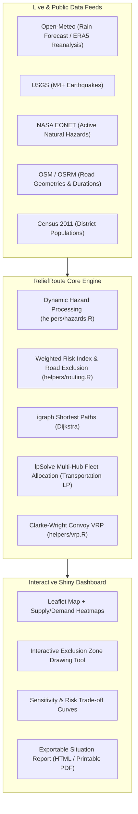

# ReliefRoute India v2 - Dynamic Humanitarian Supply-Chain Router (R / Shiny)

An interactive **R Shiny + Leaflet** decision-support dashboard that plans relief-truck routes across India
while **avoiding shifting hazard zones**. Instead of optimising only time or distance, it optimises a custom
**Weighted Risk Index (WRI)**, lets users **draw live no-go polygons** on the map, **splits stock between hubs**
with linear programming and **plans multi-stop convoys** (vehicle routing).

> Educational prototype. Not an official disaster-management tool yet.
> advisories (emergency 112, disaster helpline 1078).

## What is new in v2

| Upgrade | Where |
|---|---|
| **Real OpenStreetMap roads** (geometry, km, travel time) via one-click OSRM download | Data & Method tab, `helpers/osrm.R` |
| **Real hazard data:** rain forecast + **GloFAS river-flood signal** + USGS quakes + NASA EONET | `helpers/hazards.R` |
| **Replay real disasters** with ERA5 rainfall (Kerala 2018, Chennai 2015, Uttarakhand 2013, Fani 2019, Assam 2024, or any dates) | Situation tab |
| **Convoy Planner** - capacitated VRP (Clarke-Wright savings): multi-stop tours save kilometres | Convoy tab, `helpers/vrp.R` |
| **Risk-aversion sensitivity** chart (lambda 0-10) | Route Compare tab |
| **Upload your own hubs/camps** (CSV, snapped to the nearest network city) | Resources tab |
| **Situation report** download (HTML, print to PDF) | Fleet Plan tab, `helpers/report.R` |
| **Guided tour**, situation banner, redesigned colourful UI, mobile-friendly CSS | whole app |
| **Config file** - all model constants in one place | `helpers/config.R` |
| **testthat tests + GitHub Actions CI** | `tests/testthat/`, `.github/workflows/tests.yml` |

## Features

| Requirement | Where it is in the app |
|---|---|
| Route optimisation | `igraph` Dijkstra on a risk-penalised cost + `lpSolve` min-cost fleet allocation + VRP convoys |
| Supply-demand heatmaps | Leaflet heat layers (demand = warm, hub supply = blue) via `leaflet.extras` |
| Shiny dashboard | `shinydashboard`, 7 tabs, value boxes, interactive tables and charts |
| Public dataset integration | Open-Meteo (forecast, flood, ERA5), USGS, NASA EONET, OSM/OSRM, Census-2011 populations |
| Custom risk metric | **Weighted Risk Index** with tunable weights and risk-aversion slider |
| Dynamic exclusion zones | Draw polygons/rectangles or drop circles; roads closed with `sf::st_intersects()` |
| Made for India | 48 cities, rupee costs in lakh/crore style, English + Hindi labels and help |

### The Weighted Risk Index

```
WRI  = 100 * (wH*H + wR*V + wS*S) / (wH + wR + wS)      # 0-100 per road segment
time = base_time / (1 - 0.45*H)                          # hazards slow trucks
cost = time * (1 + lambda * WRI/100 * 2)                 # lambda = risk aversion (0 = GPS-like)
```
`H` hazard exposure (live + replay + simulated + user circles), `V` road vulnerability, `S` access constraint.
Roads touching a no-go polygon, or with severe hazard, are deleted from the graph.

## Run it (RStudio)

1. Install **R** (>= 4.1) and **RStudio**.
2. Download/clone this folder and double-click **`ReliefRoute-India.Rproj`** (sets the working directory).
3. Open **`app.R`** and click **Run App** (first run installs missing packages).
4. Press **Fetch live hazards**. For real roads: *Data & Method* tab > **Download real road geometry**, then restart the app.

Run the tests: `testthat::test_dir("tests/testthat")`.

## System Architecture



## Project structure

```
ReliefRoute-India/
├── app.R                      # Shiny UI + server
├── helpers/
│   ├── config.R               # all model constants + historical event presets
│   ├── geo.R                  # haversine, polygons, formatting (rupees, hours)
│   ├── hazards.R              # scenarios + live/historical API clients
│   ├── routing.R              # network (sf + igraph), WRI, Dijkstra, transportation LP
│   ├── osrm.R                 # real-road downloader
│   ├── vrp.R                  # Clarke-Wright convoys
│   └── report.R               # situation report
├── data/                      # nodes, roads, SOURCES.md (data provenance)
├── data-raw/build_real_roads.R
├── tests/testthat/            # unit tests
├── .github/workflows/tests.yml
├── docs/RESEARCH.md
└── CITATION.cff               # academic citation metadata
```

## Testing & CI

Unit tests cover network topology, geometry helpers, WRI cost calculations, road closure logic, and fleet allocation problems:

```r
# Run all unit tests locally in R / RStudio
testthat::test_dir("tests/testthat")
```

Automated continuous integration is configured via **GitHub Actions** (`.github/workflows/tests.yml`), running on `ubuntu-latest` with R 4.x on every push and pull request.

## Troubleshooting

| Problem | Fix |
|---|---|
| "Please set the working directory" | Open `ReliefRoute-India.Rproj` |
| No draw toolbar / heat-maps | `install.packages("leaflet.extras")` |
| `sf` fails to install on Linux | install `libgdal-dev libgeos-dev libproj-dev libudunits2-dev` |
| A live feed says "unavailable" | Check internet/proxy; the other feeds and the simulated scenarios keep working |
| Real-road download fails | The public OSRM server may be busy: try again later; the app works without it |

## Limitations

* Default network = 48-city highway corridors; real OSM geometry replaces the straight lines after the download,
  but it is still a corridor graph, not every street.
* Hub stock, road vulnerability and security values are **assumptions** (see `data/SOURCES.md`); populations are
  rounded Census-2011 figures typed in manually - verify them.
* ERA5 rainfall is 0.25-degree reanalysis (smooths extremes); the GloFAS signal is a screening indicator.
* India-WRIS/CWC gauges and IMD district warnings are future extensions.

## Credits

Open-Meteo (CC BY 4.0), USGS, NASA EONET, OpenStreetMap contributors, OSRM, Esri and OpenTopoMap basemaps,
Census of India. Licence: MIT (see [LICENSE](LICENSE)).
